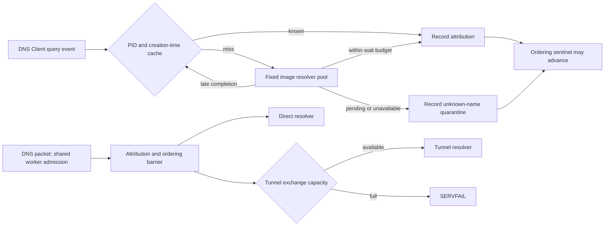

# DNS outage isolation

The dispatcher keeps the existing final-path identity and ETW ordering rules. These changes bound the work that can delay attribution or consume query capacity; they do not change payload filters, route selection, the tunnel driver, DNS cache separation or health-check cadence.

## Capacity during a tunnel outage

At most 256 UDP queries/TCP clients hold the shared worker budget. At most 128 tunnel upstream exchanges may be outstanding, including UDP truncation completed over TCP. A reservation is released before withholding checks, delivery and diagnostics, including on exceptions. Direct exchanges do not acquire it. Excess selected work receives `SERVFAIL` promptly and never falls back to a direct resolver.

This protects direct capacity from sustained slow tunnel exchanges. It does not reserve admission before classification, protect against arbitrary ingress floods or guarantee direct DNS when physical resolvers also fail. Selected and unlisted lookups of the same name can still share tunnel provenance under the existing privacy rules, so the outage test uses distinct names for the two groups.

`tests/Test-DnsCapacityLive.ps1` runs only on a disposable Windows host without an installed split or a conflicting DNS listener. It uses the real DNS Client, ETW and a unique NRPT namespace. It compares the unchanged pre-hardening build with the new build at 100 selected and 20 direct queries per second, checks selected queries never receive direct answers, and resumes the same tunnel responder to verify recovery without replacing the dispatcher. CI builds the pinned baseline from `dd5ddfa8beca0c0ef2fe5e1c99d637a3bec96741`.

## Image resolution

Canonicalization can block in a filesystem or an antivirus filter. Four workers perform it outside the ETW consumer. Sixteen fixed slots own their process handles; a request for an already pending PID/creation-time pair reuses the existing job and original deadline. All processes also share a 150 ms waiting budget per one-second window, so a stream of slow new processes cannot accumulate a full wait for each event ahead of ordering sentinels. This is a fixed-window budget, not a hard real-time scheduling guarantee. There is no unbounded thread creation, handle collection or queue of query names. If all workers are overdue, or slots are full, new misses fail closed immediately. A process cache hit still works independently of those workers.

The consumer records unknown attribution before handling the next sentinel. Its ten-second quarantine protects both direct decisions and direct answers, including when another process already supplied unlisted evidence for that name. A late completion only inserts the resolved path into the 2,048-entry LRU cache; it never edits a DNS hint or shortens quarantine. Selection is evaluated against the current included list, including after a reload.

The cache includes the process creation time, so an earlier lifetime's delayed result cannot overwrite a reused PID's entry. Failed resolutions have a one-second cache lifetime. The existing race between an ETW event and opening its PID is not a formal process-origin guarantee; these changes preserve the current operational isolation boundary.

No device-wide breaker is used: a slow executable on C: should not automatically quarantine every new process on C:. If four distinct resolutions remain stuck, uncached identities are refused until workers recover. The fixed bound is deliberate; it does not promise availability against an arbitrary number of stuck kernel operations.

Native process names were considered as a replacement for final-path identity. They have not been substituted for it because all alias, network-path, Unicode and image-rename cases would need independent WFP/DNS equivalence proof. An unproven mismatch must not classify a selected application as direct.

## Logging and shutdown

All dispatcher diagnostics go through one asynchronous writer. A fixed 256-slot ring holds at most 256 KiB, with a 64 KiB per-message limit. A brief queue lock covers only fixed memory operations; allocation and sink I/O occur outside it. Ordinary contention does not lose messages. Full queues, oversized messages or an unavailable writer drop/count diagnostics, and drops wake the writer so even a final lost message is reported once the sink can progress. Only the writer touches the existing 8 MiB log and its three archives. Console diagnostic mode uses the same queue for stdout. Dropped logs do not discard attribution state, and normal DNS integration requires zero drops.

Barrier-failure diagnostics run outside the hint mutex. Lost-event safety state and barrier progress are applied before logging. Lane-full details are rate-limited, and the background flusher reports refusal counters; the receive loop and TCP acceptor never wait for a log write.

Resolver and logger shutdown each request cancellation and wait at most one second. Workers own their slots, callbacks, events and sinks through shared state. An operation that ignores cancellation retains that state until it returns or the process exits, rather than accessing freed dispatcher memory. Fixed workers are created once per dispatcher; no retry spawns additional workers behind a stuck one.

Native self-tests inject stuck resolvers, reused PID cache keys, pool exhaustion, late completion across a reload, an uncancellable logging sink and a held old log mutex. They check bounded waits, retained quarantine, handle stability, independent progress and safe shutdown. They use private memory/events and ephemeral loopback sockets; the privileged DNS policy/load fixture remains CI-only.

A separate CI-only build injects five-second resolutions for twenty `stall-*.exe` clients. The real DNS/ETW fixture requires cached-process direct DNS to retain at least 99% success without incomplete barriers, and checks the direct resolver never received a stalled selected name. The shipped dispatcher has no runtime switch for this fault. Healthy logger contention is tested with eight producers and acknowledgements keeping occupancy below eight, so zero-drop verification does not confuse intentional queue overflow with lock contention.

There is no dispatcher-only extension of long-path identity. The existing shared final-path helper is used; if an image cannot be opened/canonicalized, its DNS attribution is unknown and fails closed. Broader long-path/alias support requires the same changes and identity tests in both the WFP record builder and dispatcher.
